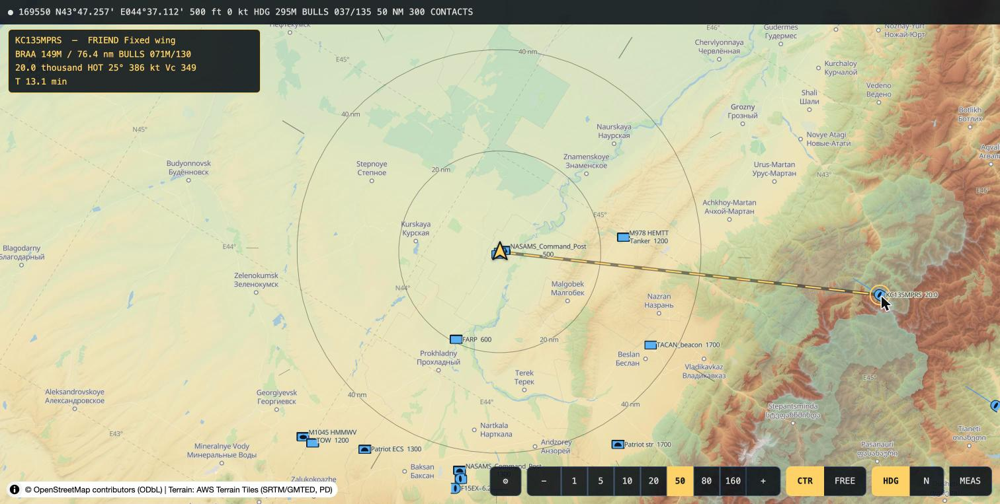

# dcs-map-server

A live map for DCS World — see your aircraft and everything around it on your phone,
tablet, or a second screen while you fly.

It runs once, on the same PC where DCS is installed. Every other device just opens a web page —
nothing to install on the tablet, no app store, no account, no internet connection needed. It all
stays on your own home network.

## Setting it up

1. Download this project — the green **Code → Download ZIP** button on GitHub — and unzip it.
2. **Double-click `start.bat`.**

That's it. It works out which DCS maps you own by itself and sets everything up — nothing to
answer. Bought a new map? Just double-click `start.bat` again, it picks that up too. (Can't figure
it out automatically? It asks once instead — double-click **`configure-maps.bat`** any time to
change the answer.)

**Open the web address it prints:** `http://localhost:8080` on the DCS PC itself. From a phone or
tablet on the same Wi-Fi, use one of the other addresses it lists instead — something like
`http://192.168.1.23:8080` or `http://<your-pc-name>.local:8080`. Start or join a flight in DCS and
the map comes alive.

## Where the map comes from

The map is the real world, not DCS's own map. Roads, towns, rivers, runways and airfield names
come from [OpenStreetMap](https://www.openstreetmap.org/). [Protomaps](https://protomaps.com/)
turns that into a worldwide map file, and setup downloads the part each theater covers into
`tiles\<theater>.pmtiles`. Airports have no separate source: runways and airfields are part of
that same file. The terrain shading is public-domain elevation data, loaded from the internet
while the map is open.

Most of the time this matches DCS, but not always. An airfield that DCS has but that was closed,
rebuilt or never built in reality is shown the way OpenStreetMap has it today. Nothing on the map
is checked against DCS's own data. Only the aircraft, ships and ground units come from the game.

## Documentation

- **[Handbook](docs/MANUAL.md)** — using it: the controls, keeping a tablet's screen awake, other
  theaters, troubleshooting a blank map.
- **[Technical guide](docs/DEVELOPERS.md)** — architecture, wire protocol, running it without DCS,
  the [manual setup](docs/DEVELOPERS.md#manual-setup) for development, changing the code.

## Contributing

Clone it, fly with it, break it. Bugs, rough edges and ideas are all welcome as
[issues](https://github.com/gentzl/dcs-map-server/issues), and pull requests just as much.
Contacts drawn with the wrong symbol are worth reporting in particular: the map recognises units
by their DCS type name, and nobody flies every asset pack there is. The
[technical guide](docs/DEVELOPERS.md#contributing) has what to know before sending a change.

## Credits

Built on [MapLibre GL JS](https://maplibre.org/) for the map, [Protomaps](https://protomaps.com/)'
[PMTiles](https://github.com/protomaps/PMTiles) format, planet builds and
[go-pmtiles](https://github.com/protomaps/go-pmtiles) for the tiles themselves, and
[Fastify](https://fastify.dev/)/[ws](https://github.com/websockets/ws) for the server. Map data is
© [OpenStreetMap](https://www.openstreetmap.org/copyright) contributors (ODbL); terrain is
public-domain SRTM/GMTED. Full attribution and licenses in the
[technical guide](docs/DEVELOPERS.md#license-and-data-sources).

## License

Code is MIT licensed, see [LICENSE](LICENSE). Map and terrain data are open (OpenStreetMap/ODbL,
public-domain terrain) — see the [technical guide](docs/DEVELOPERS.md#license-and-data-sources)
for the details and attribution. This project is not affiliated with or endorsed by Eagle Dynamics.
