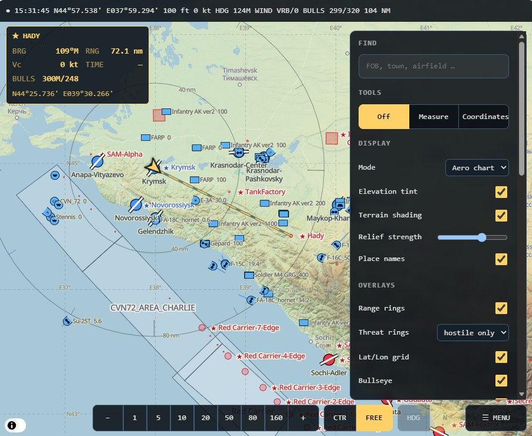

# dcs-map-server

A live map for DCS World — see your aircraft and everything around it on your phone,
tablet, or a second screen while you fly.

It runs once, on the same PC where DCS is installed. Every other device just opens a web page —
nothing to install on the tablet, no app store, no account. Your flight data stays on your own
home network; only the terrain shading is loaded from the internet while the map is open.

## Setting it up

1. Download this project — the green **Code → Download ZIP** button on GitHub — and unzip it.
2. **Double-click `start.bat`.**

That's it. It works out which DCS maps you own by itself and sets everything up.

**Open the web address it prints:** `http://localhost:8080` on the DCS PC itself. From a phone or
tablet on the same Wi-Fi, use one of the other addresses it lists instead — something like
`http://192.168.1.23:8080` or `http://<your-pc-name>.local:8080`. Start or join a flight in DCS and
the map comes alive.

**Joining a multiplayer server?** Some servers don't let any outside program see the other units —
then the map shows only your own aircraft and says so at the top (*server blocks other units*).
That's the server's setting, not a fault; the [handbook](docs/MANUAL.md#my-aircraft-shows-but-no-other-contacts)
has the details.

## Documentation

- **[Handbook](docs/MANUAL.md)** — using it: the controls, keeping a tablet's screen awake, other
  theaters, troubleshooting a blank map.
- **[Technical guide](docs/DEVELOPERS.md)** — architecture, wire protocol, running it without DCS,
  the [manual setup](docs/DEVELOPERS.md#manual-setup) for development, changing the code, and
  [where the map data comes from](docs/DEVELOPERS.md#where-the-map-comes-from).

## Contributing

Clone it, fly with it, break it. Bugs, rough edges and ideas are all welcome as
[issues](https://github.com/gentzl/dcs-map-server/issues), and pull requests just as much.
Contacts drawn with the wrong symbol are worth reporting in particular: the map recognises units
by their DCS type name, and nobody flies every asset pack there is. The
[technical guide](docs/DEVELOPERS.md#contributing) has what to know before sending a change.

## Credits

Built on [MapLibre GL JS](https://maplibre.org/) for the map, [Protomaps](https://protomaps.com/)'
[PMTiles](https://github.com/protomaps/PMTiles) format, planet builds and
[go-pmtiles](https://github.com/protomaps/go-pmtiles) for the tiles themselves, and
[Fastify](https://fastify.dev/)/[ws](https://github.com/websockets/ws) for the server. Map data is
© [OpenStreetMap](https://www.openstreetmap.org/copyright) contributors (ODbL); terrain is
public-domain SRTM/GMTED. Full attribution and licenses in the
[technical guide](docs/DEVELOPERS.md#license-and-data-sources).

## License

Code is MIT licensed, see [LICENSE](LICENSE). Map and terrain data are open (OpenStreetMap/ODbL,
public-domain terrain) — see the [technical guide](docs/DEVELOPERS.md#license-and-data-sources)
for the details and attribution. This project is not affiliated with or endorsed by Eagle Dynamics.
